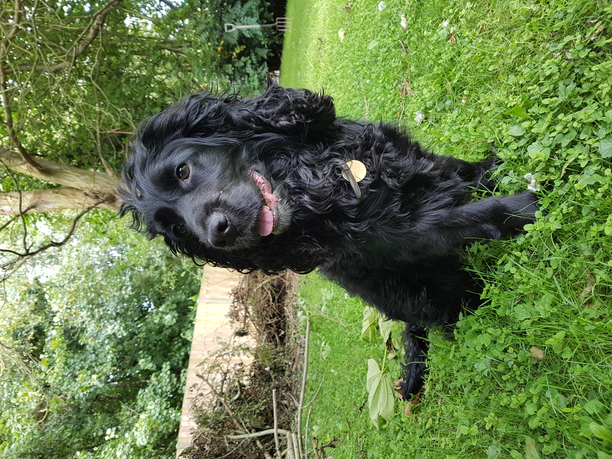

Ascii art has always been an interesting topic to me. Though it's style may seem a little dated it still finds plenty of use amongst modern terminal emulators today.

The idea of creating images using nothing but text also decouples viewing pictures from having a device or software capable of interpreting the file format and rendering the image to a screen.

## The Methodology

The idea behind ascii art is nothing new and the technique I'm trialing is based on this [1997 piece](http://paulbourke.net/dataformats/asciiart/). The essence of the method is:

1. Convert the image to grayscale
2. Map each pixel to a text character
3. Write the text file, OR display to the console

## Converting the image to grayscale

As always I underestimated the different approaches for doing this. There are multiple implementations to do with how humans percieve red, green and blue colour channels.

A blog post could stand on it's own to list the various merits of each appraoch but I've opted for the simplest, averaging out each value e.g (R+G+B)/3

## Mapping pixels

The real magic of ascii art happens via this character array:

```text
$@B%8&WM#*oahkbdpqwmZO0QLCJUYXzcvunxrjft/\|()1{}[]?-_+~<>i!lI;:,"^`'. 
```

The idea being that whiteness can be represented pixel dense characters and darkness by pixel sparse characters and that's really the whole trick.

## Picking an image

I've chosen to attempt to recreate an image of my (recently passed :'( ) dog Dexter. This image is large, too large to insist upon a character per pixel mapping strategy.

Leaning upon some basic scaling we'll make it smaller and apply the process above, the original:



The result:

```text
LLqkcp0w\kmiw/[0dOhu0WWXu)>[<f[iY)QQzn!0rcY-npUJqC
dbcJm0d0h* mYYwCUbLwC%@|x)(|x\vxj-zxn?cQrcr\mUfuhZ
JoJqqkm{0wjX{Z tqO}dUh&{(__{?|Yxc\+JxrpY{p|bLJqaJ8
mdYYobpoq0JmQoOaQ0d8Wtht1]|+(U+\XpXvd_hYzu~XQqqqM}
q0xqu0pkoomdkU0ZcZp%dL%rj-?}(rv{Q-vnY#)p?qOnh}~rYX
UJ0UucwwObmpbmdpQQQUUZ8rxl1{ftxnYvCL()czr\_r}fzY}t
hUkwntavqqkmLCOQvCLUuq)j\~1v\[xxYL\Zc0Q)cYjO#uzktZ
?1jdpdLw0dZkwmOqbuoXQCkdCX?xrf+}f1CnpzbqrLu(}Xnuf1
OcXCOh]Zk0wphbXmdL@UCh#o*W&|}t1xv(Ld+frp0YJq}\#C0x
1wYfmrOJumrkpU0XuwmOqZb*o%8XCYvjf|tU{*cJ0oYXkd{/r_
COfmzxUOOYaX*aW#WWW&a&oW%%&#ZuJpYrffrt()J[fU1/u0kw
,0tX|uhbhkoQ%pqXJcv@%b#%%B%BM*hWWLc\xtjfZUbd/cQ[|u
m)aOX8#BaohvOLCJ*k*M*%8W*h%#MkmW*dL\0vwrj)k](uj\\\
\[hJLw*kxhULucuXfZZdhhWZjdMY~'*aOzZco*pozZrtv|i10p
_Z1v0|/zcwXvL&81ujpw1z%Om-%Mn^mw8b*oMM@u{aZltc8j\n
LwpY#Ct1jjYxzWoavnn/rQdO&wW@8k%*o%8WdQtW-rCl8Jzf8n
n+[]?{1)zOt0Ldb|x/xuxCIkzo%kM##8L&pmc8MXzzQkQqrZXc
~+|(t`}?[[Ovz&QtzwzU8CfxM$%Bp@bahhwxmpQaWM0Cdf(mXZ
j~) xt]X){1tQB&cw[@mQZmm8B%Wmb@W&ZChh*#*WMM@L|(cj[
l_,^,t+uc/j\MW%&zY&8WYBB%&%&cMoh#hbp*#*Mb80pCdWLr%
,I{d+.+>}<;{]nB8&qb#%M%&Bo8*oWW#%8WooWZZMQ*fQ|#Yod
.z?|?.{}}(\itzYx#B%*M888%&WWWM&%*a8&B&o#aOz0rQCL#o
n{.  ?\]x\xffJmr~iI@@*h/k(khM%%BBBB%%$&@z8mzLYCMcO
"?`t{!]_i|!Udx0aI!,/\/U)}tnpaM8W%BB%B%%%@&Wnqrwhpq
f`)ji:ji{1jC00nmI"`xJcUv(r?)}a*&*8oBB%%xOcp0thuXnn
~i>C.XrQ~uww!uhr`'^}]0Urrr<)t\U&Wh*&8B@X*WzUCCdOjC
>-)f Y;xfLvwxYwZ^``Juq\f{UYx{jXzoW#BMBQuMkw0oLQboc
[t_a p0-^>Z0XJw(`l"m1LwL\rvx)\Z}n$BcB%QCwhbqCOZMaZ
(m|q\pm>vLOLZoO0,:_I,[o/n/uUCur{(Q@nZLUomCYCuJ*x#n
-(\,IUv?jOmv*Wzx:"I):CCcnn}zvj0v0m8xpcOnrUJYz%upwq
]1X:;/jU}\ZufnoI~t:I|U8X(YzXvf~)thbYYO0tddc0xZUv*O
|\1x[)1|u#o0{/8":_CZCoJrYCfY/j{c10Bd#zWZL8QwUQfOou
"-;{C({X0Zo~(Lhl-cx<ZJCYx)j(Oz<)j@YmbxmLUzOr0X*YOv
t[<qxxbdoZq1-?k>j_Jp*o1riJvxxz/+avpkmOCCu8UccUoprJ
|]jO]rQOLwX"(pr'LJfUw#}b|rzrr\~rXYYrzjYq0k*xzo0zOZ
zJt|rwommpm;0rW>)@0dp&~huYzvutjd|vdxJn|kdXUuUbqv/Y
pucZwmhhpxl:[#c:\w/Zqp\|]/cZr/YJOJn&(hLdnQmXpw0bdO
{cbdYkIUY[nUn*;m*LhkY%z>Unmn\C\YzLQuw0pwfkUfJbqUmZ
```

Can you see him? Neither can I...

## Fixing it (kinda)

The problem with this representation is that there isn't enough contrast, we'll remove the background and try again:

                                                      
                            ^v\J)c.                   
                           [ bxcQkmxI                 
                           >{vqJucQczwq~              
                         .vb0UUYXUOOa&&Q              
                          qw8w00owr0WWMLY             
                         0*B8Wwh&W000a&mY             
                       .M*Wh8wZk8bmndp&Wwu            
                        8&880uvhj#8uZX&MYL.           
                        %8WzfttqQ/rmLYB*dJk           
                      ._8*vCYvfXZcwXaXB%wo0           
                       m8OvcLkfxzvvzhC%&kwq           
                       $8WbY?CwxnjvUkZ#a8Yz           
                      Q8M%a%JqzCJLwp**%Waqu           
                      *W&WWoZkf\CkoMMukWum0           
                      %88kMbpwjtxkaJ*ohMLUl           
                      a&8*bmqJJr0cw#hWwbqY?           
                      WM&8hadkCOz\X%*W%&qMU           
                      M&8%|)}+x1nkb88q&*hmz1          
                      %W%8mdfu}\qMm*8o%okwhk          
                      k888%0uYvOphwqW#Bx#oax          
                      %8M8%8MOwozaaWM&%mWaQ(          
                      %8&W88##z*kxqcWW%Bk#Ur          
                      MW*&8%&cwqznW0#BBB%Mk           
                      >*#M%8%o8dxrpdk%%8%WY           
                     capo88M%mkkLuL#k888&8O           
                    .kWkM&8W%@h8wohWo*MZ-             
                   .k*&M**#h%*CdM\/wawdb              
                   po&WMhM8kOW0#(?lwoa0w              
                   hMW8*&aMk&W#op^:aapLc              
                  a#&%WW&MhkMoMoYmp8WMkz              
                 [W8%%&&&*hk##oo8Mbw&dU]              
                ,MM&M%W&Wohooq8Wd*o*kMMI              
                oW88W%%MWM#WWkZ&Q*bkb8#               
       wC!.' 1n.&o888B%#*##oM&W%ommh#*{               
       'Wkwdpp8bMWM%BB%MW##a88%B%hdOo                 
        WWWb#@@W&8*&B%B%Wak0#aa%%W08u.                
             x {8MMB@%%8MhdmQJq*8avo                  
                &W%BB%%%*ahMZ**#abom                  
                W8%%%%B%*ha*qbUa0*hX                  
                BB%%88B%M**#kb&hdQ*^                  
                 8*B%%WWoMa#dzMbZ%o                   
                 Q@B%W8r ho#kX:|QWW                   
                  hW&,    *aoY  XbM                   
                          #q*mr +#M.                  
                          q&&oU  `>`                  
                          8&8ac                       
                          8W#LU.                      
                          w%mUCb                      
                          .{b0*c                      
                           xjzUp                      

The result is certainly more satisfying, however if we increase the scaling and zoom out upon the text generated we can get some even better results:

<embed type="text/html" src="https://raw.githubusercontent.com/sgregory8/sgregory8.github.io/master/images/2017_handsome_man.html">

There are multiple things that we can tweak here including the character map so we can fine tune the results. This is where I'll be leaving it today though


