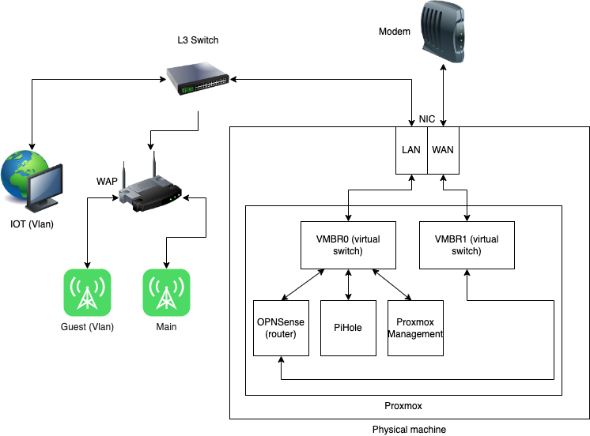

It's not often that I have considered what happens in my local area network. For the longest time I've subscribed to the standard model of procuring internet from the cheapest ISP and plugging in their modem/router/switch device. BUT all this convenience comes at a cost:

- No options to pick WiFi hardware
- Opaque procedure on firmware updates
- VLan support? Forget about it

Today marks the day I complete my home network setup to logically seperate 3 subnets for:

1. My personal network (working, gaming etc)
2. Guest network (for visitors)
3. IoT network (anything internet of things related e.g smart heating)

## The Process

So how does one start this logical isolation? First things first and that's replacing the ISP shipped router. I chose to purchase an older Dell Optiplex machine from an old office. It represents good value and upgradability in the future. I also chose to purchase a dual port NIC to simplify the networking setup though a single port NIC would suffice if needed.

My idea is to run [Proxmox](https://www.proxmox.com/en/) to create a virtualised environment housing [OPNsense](https://opnsense.org/) (to run my router) and [Pi-hole](https://pi-hole.net/) for ad blocking and custom DNS resolution.

This covers the machine and virtual environment but other hardware is also neccessary to complete the setup. As I'll be creating VLans to maintain isolation between networks so I bought a L3 switch and a wireless access point also capable of broadcasting multiple SSID's om multiple VLans through tagging.

## Installing Hardware and Proxmox

The second hand Optiplex machine came in decent condition and a Windows install. I actually chose to remove the hard drive entirely (to make the machine slightly cheaper to run) and replace it with a SSD to load Proxmox onto.

Adding my additional NIC was no problem as the machine came with a spare PCIx16 slot. I was unable to get video signal through the motherboards onboard display port slot so resorted to VGA to install Proxmox and boot the system.

## Configuring Proxmox Environment

Once Promox is installed it's straight forward to add additional VM's. I downloaded an OPNsense .iso and a Debian .iso (for Pi-hole). Running through the installers for both created two VM's running in my Proxmox environment. Both VM's can talk to each other by default as Proxmox networking configures a virtual switch which is easily attached to both VM's.

To mandate that all internet traffic travels through OPNsense only I created a second virtual switch within Proxmox and attached it my OPNsense VM only.

## Configuring VLans

To keep segregation in my LAN I configured my wireless access point to tag all trafic on my guest SSID and leave traffic on my main SSID untagged. The L3 switch also tags traffic on behalf of the IoT network.

OPNsense firewall is configured to prevent any inter subnet communication. So the IoT subnet cannot talk to the guest subnet and vice versa. The main subnet is not reachable from guest and IoT subnets either BUT it can initiate connections into those subnets should it need to.

## Pi-hole

Pi-hole is used for ad blocking within all networks. It maintains a blocklist of all DNS names that might be used to serve adds and by configuring OPNsense to use Pi-hole as a DNS resolver it will not resolve to anything on the block list.

It also allows for customisation of local DNS so I can serve my OPNsense configuration to a memorable DNS name as opposed to an IP address to be comitted to my own memory.

## Network Topology

## What's Next?

Now I have a working setup I'd love to extend this by creating VM's isolated by VLAN. Currently all VM's are provisioned on my main subnet which is fine but it would be cool to do analysis of my IoT subnet through additional VM's in Proxmox.

This platform also allows me to host web servers, content servers and anything else I might like to have on my network. So the next BIG project might consist of cabling my house to support 10 gigabit speeds... it's a pipe dream for now though!
